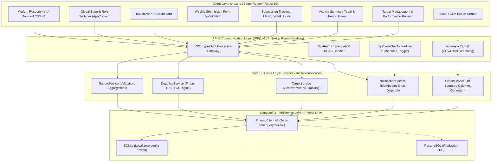

# Office Manager (OM) Weekly Report Management System
## System Architecture & Technical Design Specification

### 1. Executive Summary
The **Office Manager (OM) Weekly Report Management System** is an enterprise-grade full-stack platform designed to automate and centralize field reporting, submission tracking, activity rollups, target achievement analysis, and administrative oversight.

It replaces error-prone manual spreadsheets with a unified system following the core paradigm:
> **Enter Data Once → Automatically Calculate → Dashboard KPI → Summary Rollups → Excel Report → Automated Email Alerts**

---

### 2. High-Level System Architecture



---

### 3. File & Folder Structure Blueprint

```
report-management-fullstack-t3-app/
├── docs/                                  # Comprehensive System Documentation
│   ├── ARCHITECTURE_AND_DESIGN.md        # Technical design & structural diagrams
│   ├── BUSINESS_LOGIC_AND_SPEC.md        # 59-point requirement implementation mapping
│   ├── DATABASE_SCHEMA.md                # ERD, models, constraints, and relations
│   ├── API_DOCUMENTATION.md              # tRPC routers & RESTful endpoints
│   └── DEPLOYMENT_GUIDE.md               # Local, Docker, & Cloud deployment instructions
│
├── prisma/                                # Database Management
│   ├── schema.prisma                     # Prisma Data Model (User, Report, Target, etc.)
│   ├── seed.js                           # Seed script with realistic OM and Report data
│   └── dev.db                            # SQLite local database file
│
├── src/
│   ├── app/                              # Next.js 15 App Router
│   │   ├── _components/                  # Modular React UI Components
│   │   │   ├── AppContext.tsx            # Global state, active profile, toast notifications
│   │   │   ├── Icons.tsx                 # Zero-dependency SVG icon system
│   │   │   ├── Navbar.tsx                # Role switcher, month/week/zone filters, navigation
│   │   │   ├── MainApp.tsx               # Primary tab switcher container
│   │   │   ├── DashboardView.tsx         # 6-section Executive Operations Dashboard
│   │   │   ├── SubmitReportModal.tsx     # 5-step intuitive submission form with live validation
│   │   │   ├── SubmissionTrackingView.tsx# Week 1-4 status matrix (Submitted, Pending, Late)
│   │   │   ├── ActivitySummaryView.tsx   # Multi-dimensional summary table & period filters
│   │   │   ├── TargetManagementView.tsx  # Monthly target setting, achievement gauges & rankings
│   │   │   ├── OmManagementView.tsx      # OM directory, user creation, zone management
│   │   │   ├── NotificationView.tsx      # Configurable email rules, senior CCs, audit history
│   │   │   ├── ExcelExportView.tsx       # Standard 18-column Excel preview and download
│   │   │   └── FindingUpdateModal.tsx    # Market visit finding status update dialog & audit trail
│   │   │
│   │   ├── api/                          # Next.js Server Route Handlers
│   │   │   ├── auth/[...nextauth]/route.ts # NextAuth authentication endpoint
│   │   │   ├── export/excel/route.ts      # Direct file download API for Excel (.csv)
│   │   │   ├── cron/check-deadline/route.ts# Friday 11:59 PM deadline notification scheduler
│   │   │   └── trpc/[trpc]/route.ts       # tRPC HTTP handler
│   │   │
│   │   ├── layout.tsx                    # Root HTML layout with providers and fonts
│   │   └── page.tsx                      # Root Server Component (queries initial DB data)
│   │
│   ├── server/                           # Backend Business Logic & API Layer
│   │   ├── api/
│   │   │   ├── root.ts                   # Root tRPC AppRouter
│   │   │   ├── trpc.ts                   # tRPC initialization, context & middleware
│   │   │   └── routers/                  # Modular tRPC Routers
│   │   │       ├── report.ts             # Submissions, tracking matrix, activity summary
│   │   │       ├── target.ts             # Target setting, achievement formulas, comparison
│   │   │       ├── om.ts                 # OM roster, zones, active/inactive status
│   │   │       ├── dashboard.ts          # Section 1-5 calculated metrics
│   │   │       ├── notification.ts       # Notification config, logs, deadline check
│   │   │       └── export.ts             # 18-column tabular data extraction
│   │   │
│   │   ├── services/                     # Domain Service Layer
│   │   │   ├── deadlineService.ts        # Friday 11:59 PM deadline algorithm & calendar logic
│   │   │   ├── reportService.ts          # Validation (Solved+Pending=Finding), aggregation
│   │   │   ├── targetService.ts          # Achievement % formula, leaderboard ranking
│   │   │   ├── notificationService.ts    # Missed submission scanner, dynamic email renderer
│   │   │   └── exportService.ts          # Excel 18-column formatter & CSV generator
│   │   │
│   │   ├── auth/                         # Authentication & Permissions
│   │   │   ├── config.ts                 # Credentials provider with Staff ID / Email lookup
│   │   │   └── index.ts                  # NextAuth exportable instances
│   │   │
│   │   └── db.ts                         # Singleton Prisma database client
│   │
│   ├── styles/
│   │   └── globals.css                   # Tailwind CSS styling and theme configuration
│   │
│   ├── trpc/
│   │   ├── react.tsx                     # React Query & tRPC React Client provider
│   │   ├── server.ts                     # Server-side caller for Server Components
│   │   └── query-client.ts               # TanStack Query client configuration
│   │
│   └── env.js                            # Type-safe environment variable schema
│
├── package.json                          # Dependencies and project scripts
├── tsconfig.json                         # Strict TypeScript configuration
└── .env                                  # Environment variables
```

